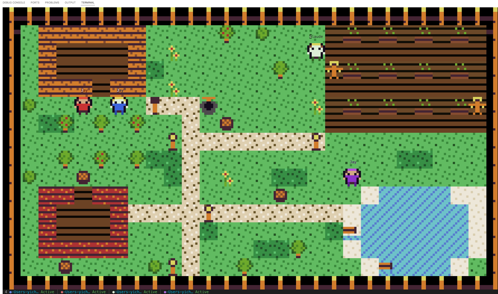

# Harvest Claude

> Harvest Moon meets Claude Code — a pixel-art farm where your AI agents come to life.

Terminal pixel-art visualizer that renders running [Claude Code](https://docs.anthropic.com/en/docs/claude-code) agents as animated farm characters in a Stardew Valley-inspired scene using the [Dawnbringer 16-color palette](https://lospec.com/palette-list/dawnbringer-16).

## Install

Requires Rust 1.85+ and a 24-bit color terminal (iTerm2, Kitty, WezTerm, Alacritty, Windows Terminal).

```sh
cargo install --path .
```

## Usage

```sh
harvest-claude
```

Characters spawn automatically as Claude Code agents start working. Each agent becomes a farm worker who tends crops, rests in the cabin, fishes at the pond, or waits at the mailbox. Background sub-agents appear as companion animals (chickens, cats, dogs) following their parent character.

```sh
# Watch a directory in addition to ~/.claude/projects
harvest-claude --watch-dir /path/to/projects

# Use a custom farm layout
harvest-claude --layout ~/my-farm.json
```

**Controls:**

| Key | Action |
|-----|--------|
| `←` `→` | Cycle through agents that are not resting |
| Click | Select a character; click the selected one again to focus its terminal |
| `Enter` | Focus the selected agent's terminal (macOS Terminal.app and iTerm2) |
| Escape | Dismiss the bubble, then deselect |
| `q` or `Ctrl+C` | Quit |

The bottom panel lists one row per active agent: project, branch, status, and a one-line summary of what it is doing. Window size below 40 columns or 9 rows shows a size notice instead of the farm.

## API

### CLI Options

| Flag | Description |
|------|-------------|
| `--watch-dir <PATH>` | Directory to watch in addition to `~/.claude/projects` (repeatable, must exist) |
| `--layout <PATH>` | Path to a custom layout JSON file; default `~/.harvest-claude/layout.json` |

Logs are written to `~/.harvest-claude/logs` (three daily files). Set `RUST_LOG=debug` for more detail.

### Agent Detection

Watches `~/.claude/projects/` for `.jsonl` transcript files. Each session maps to a character with one of five states:

| State | Visual | Trigger |
|-------|--------|---------|
| Active | Farming animation at crop plot | Tool executing |
| Idle | Wandering the farm | No active tools |
| Waiting | Resting at cabin | Awaiting user input |
| Permission | Amber "..." bubble at mailbox | 7s without tool result |
| Dormant | Hidden | 10 minutes without transcript writes; a write brings it back |

### Background Agents

| Background Agent | Visual |
|------------------|--------|
| Background launch (tool result "Async agent launched successfully.") | Companion animal (chicken/cat/dog) follows its parent until the final result |

### Rendering

8x8 tile and 8x16 character sprites rendered via Unicode half-block characters (`▀`) with 24-bit color. Scene composited with z-sorting at ~60 FPS. Default farm layout: 28x16 grid with crop field, cabin, pond, stone paths, and scattered trees.

## Documentation

- [`docs/idea.md`](docs/idea.md) — Concepts, terminology, and data flow contracts.
- [`docs/design.md`](docs/design.md) — Module architecture, ownership model, and key types.

## For Agents

Agent-consumable documentation index at [`docs/llms.txt`](docs/llms.txt) ([llmstxt.org](https://llmstxt.org) format).

## License

MIT
